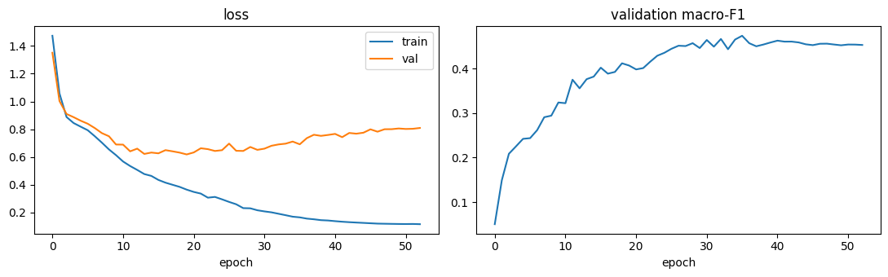
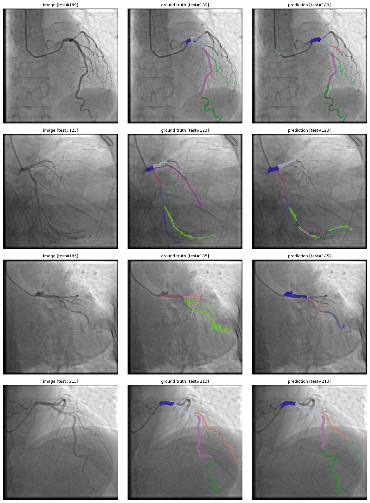

# arcade-coronary-segmentation

A U-Net with a pretrained ResNet34 encoder that segments coronary artery segments in X-ray angiography images (ARCADE dataset, SYNTAX subset).

The decoder, loss, metric, and training loop are all written with `torch` and `torchvision`.

## Results

Test split, evaluated once with the checkpoint chosen on the validation split.

| Metric | Value |
|---|---|
| Test macro-F1 (24 artery-segment classes present in the test set) | **0.43** |
| Best validation macro-F1 | 0.47 |
| Vessel-vs-background Dice (test) | 0.78 |
| Correct segment label among detected vessel pixels (test) | 75% |

Macro-F1 is pixel-level, averaged over classes that appear in the target, and excludes background. For pixels, F1 equals Dice.

### Per-class test F1

| Class | F1 | Class | F1 | Class | F1 |
|---|---|---|---|---|---|
| 1 | 0.757 | 9a | 0.339 | 14 | 0.211 |
| 2 | 0.744 | 10 | 0.234 | 14a | 0.045 |
| 3 | 0.784 | 11 | 0.747 | 14b | 0.178 |
| 4 | 0.650 | 12 | 0.166 | 15 | 0.171 |
| 5 | 0.772 | 12a | 0.119 | 16 | 0.671 |
| 6 | 0.673 | 12b | 0.142 | 16a | 0.231 |
| 7 | 0.665 | 13 | 0.614 | 16b | 0.324 |
| 8 | 0.600 | 9 | 0.320 | 16c | 0.161 |

Classes `10a` and `stenosis` have no pixels in the test split, so they are excluded from the average.

## Findings

- **Large main-vessel segments work well** (F1 about 0.6 to 0.78). **Small distal branches work poorly** (F1 about 0.05 to 0.34).
- **Confusion analysis on the weak classes.** Most of the true pixels were predicted as background (37 to 54% for classes 14, 14a, 12a, and 9). The next most common error was confusion with neighbouring branches (for example 14 with 12a/12b, and 9 with 9a).
- **Detection and labelling both limit the score.** Vessel-vs-background Dice is 0.78, and about 75% of detected vessel pixels receive the right segment label.
- **What did not work:** lowering the background logit at inference, to recover missed vessel pixels, did not help. Validation macro-F1 fell from 0.474 (no bias) to 0.458 (bias of 3). The misses therefore do not look like a simple calibration offset.

## Method

**Data.** ARCADE, SYNTAX subset: COCO-format polygon annotations for 25 artery segment classes plus a stenosis class (26 foreground classes, 27 with background). Polygons are rasterized into integer masks once when the dataset is created.

**Model.** U-Net with a torchvision ResNet34 encoder (ImageNet weights) and a hand-written decoder: four upsample, skip-connection, and double conv-BN-ReLU blocks, followed by a 1x1 classification head.

**Loss.** 0.3 x class-weighted cross-entropy + 0.7 x Dice. Class weights come from training pixel frequencies (ENet-style, capped at 10). The Dice term ignores background and skips classes absent from the batch.

**Training.** Two phases, like a fine-tuning schedule:
1. 3 epochs training the decoder only (encoder frozen), learning rate 1e-3.
2. 50 epochs with everything trainable: decoder 5e-4, encoder 1e-4.

AdamW (weight decay 1e-4), OneCycle learning-rate schedule, batch size 8, mixed precision on GPU. The best checkpoint by validation macro-F1 is kept.

**Augmentation.** Small affine transform (scale, translation, rotation up to 10 degrees) and brightness/contrast jitter. Horizontal flips are deliberately not used, because left and right coronary segments have different labels, so mirroring can make the labels wrong.

## Run it

The notebook is written for Google Colab with a GPU.

1. Open `arcade_unet_pytorch.ipynb`.
2. Install the extra packages (first cell): `opendatasets` and `albumentations`. Might also require `legacy-cgi` to support `opendatasets`. PyTorch and torchvision come with Colab.
3. The download cell uses [`opendatasets`](https://github.com/JovianHQ/opendatasets) to fetch the dataset from Kaggle. It will ask for **your own** Kaggle username and API key.
4. Run the cells in order. Checkpoints are saved to `checkpoints/`; on Colab, point `CKPT_DIR` at a Google Drive folder so they survive a runtime reset.
5. Run the final test-evaluation cell once, after training is finished.

## Limitations

- One training run with one seed, so there are no error bars. Differences of a few F1 points between runs should not be over-interpreted.
- The validation split was used to choose the best checkpoint, so the validation score is slightly optimistic. The test score is the figure to quote.
- The test split is small for rare classes, so their F1 values are noisy.
- 2D images only. No DICOM or 3D handling, and no clinical validation.
- The model seems to have overfitted as there is growing difference between validation and training loss as training progressed.

## Ideas not yet tried

- Stronger augmentation
- A loss that penalizes missed pixels more
- A stronger encoder (for example ResNet50) or higher input resolution

## Data and citation

The ARCADE dataset belongs to its authors. Please see the dataset's Kaggle page and original publication for licence terms and citation: Popov et al., "Dataset for Automatic Region-based Coronary Artery Disease Diagnostics Using X-Ray Angiography Images", *Scientific Data*, 2024. Check the citation against the dataset page before publishing.

## Author

Pabin Khanal